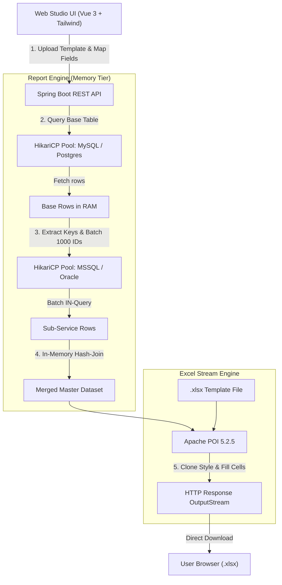

# Report Export Tool

> **Microservice Data Aggregation & Excel Stream Engine**  
> Công cụ tổng hợp dữ liệu phân tán liên cơ sở dữ liệu (Cross-Database Hash-Join) và stream nạp dữ liệu vào file Excel mẫu `.xlsx` giữ nguyên 100% định dạng ban đầu.

[](https://www.oracle.com/java/)
[](https://spring.io/projects/spring-boot)
[](https://poi.apache.org/)
[](https://vuejs.org/)
[](https://tailwindcss.com/)
[](LICENSE)

---

## 1. Bài toán nghiệp vụ & Giải pháp

Trong kiến trúc **Microservices**, mỗi dịch vụ (Order, User/Auth, CRM, Billing, Inventory) thường sở hữu cơ sở dữ liệu riêng biệt (*Database per Service*) và chạy trên các hệ quản trị khác nhau (MySQL, PostgreSQL, SQL Server, Oracle) qua mạng nội bộ hoặc OpenVPN. 

Khi cần xuất các báo cáo đối soát tổng hợp (ví dụ: *Đơn hàng từ MySQL + Họ tên, SĐT khách từ PostgreSQL/SQL Server + Thông tin xuất hóa đơn từ Oracle*):
- ❌ **Cách truyền thống:** Viết script SQL riêng lẻ, xuất các file CSV rời rạc rồi dùng VLOOKUP/PowerQuery trong Excel, vừa tốn thời gian vừa dễ sai sót định dạng.
- ✅ **Với Report Export Tool:** Người dùng chỉ cần kéo thả file Excel mẫu (`.xlsx`), kết nối các DB, chọn bảng và khóa nối. Hệ thống tự động **Hash-Join $O(1)$ trong RAM** và stream kết quả trực tiếp vào file template với đầy đủ công thức, màu sắc, font chữ và viền kẻ ban đầu.

---

## 2. Tech Stack & Kiến trúc hệ thống

### Bảng công nghệ phân tầng

| Tầng kiến trúc | Công nghệ sử dụng | Vai trò & Điểm sáng kỹ thuật |
| :--- | :--- | :--- |
| **Backend Core** | **Java 21 LTS** + **Spring Boot 3.3.4** | Nền tảng hiệu năng cao, tối ưu hóa bộ nhớ, sẵn sàng với Virtual Threads. |
| **Data Access** | **Spring JDBC** + **HikariCP** | Quản lý connection pool động cho từng DB; kết nối dạng `ReadOnly` chống ghi đè dữ liệu sản xuất. |
| **Database Adapters** | **PostgreSQL**, **MySQL**, **SQL Server (MSSQL)**, **Oracle** | Tích hợp sẵn 4 driver chính thức (`postgresql`, `mysql-connector-j`, `mssql-jdbc`, `ojdbc11`). Adapter hóa việc quote identifier và phân trang theo từng dialect. |
| **Processing Engine** | **In-Memory Hash-Join Engine** | Batching 1000 khóa (`IN (:keys)`), ghép dữ liệu độ phức tạp $O(1)$ trên RAM, triệt tiêu độ trễ mạng qua OpenVPN/LAN. |
| **Excel Generator** | **Apache POI 5.2.5** (OOXML) | Nạp template `.xlsx` có sẵn, clone `CellStyle`, giữ nguyên định dạng, tự động xử lý số dài (>15 chữ số) tránh lỗi làm tròn. |
| **Frontend Studio** | **Vue 3 CDN** + **Tailwind CSS** | Bố cục 2 cột Studio chuyên nghiệp, hỗ trợ **Light / Dark Mode**, 100% SVG Lucide-style (Anti-AI Slop), **Zero NPM build / Zero Node.js**. |
| **Security & Filter** | **Regex Whitelist** + **AccessControlFilter** | Chống SQL Injection bằng Regex `^[a-zA-Z0-9_]+$` trên identifier; HTTP Basic Auth khi bind ra mạng ngoài; không lưu mật khẩu vào disk. |

### Sơ đồ luồng xử lý (Data Flow)



---

## 3. Khởi động nhanh trong 1 phút (Quick Start)

### Yêu cầu hệ thống
- **Java Development Kit (JDK):** Phiên bản **21** trở lên.
- **Apache Maven:** Phiên bản **3.9+**.

### Các bước thực hiện

```powershell
# 1. Clone mã nguồn
git clone https://github.com/Khanhnv26/Report_Export_Tools.git
cd Report_Export_Tools

# 2. Chạy trực tiếp qua Maven Spring Boot
mvn spring-boot:run
```

*(Hoặc đóng gói thành Fat JAR và khởi chạy):*
```powershell
mvn clean package -DskipTests
java -jar target/microservice-report-tool-1.0.0.jar
```

Ứng dụng sẽ khởi động tại cổng `8080` và **tự động mở trình duyệt** tại:
👉 **`http://localhost:8080`**

---

## 4. Hướng dẫn sử dụng 5 bước (Studio Workflow)

```
[1. Kết nối DB] ➔ [2. Tải File Mẫu] ➔ [3. Chọn Bảng & Join] ➔ [4. Khớp Cột] ➔ [5. Xuất Excel]
```

1. **Thêm nguồn dữ liệu (Khung số 1):** Bấm `+ Kết nối DB`, chọn loại CSDL (MySQL, PostgreSQL, SQL Server, Oracle), nhập host/port/database/user/password và bấm *Kiểm tra & Kết nối*.
2. **Nạp file Excel mẫu (Khung số 2):** Kéo thả file template `.xlsx` vào ô tải lên. Hệ thống tự nhận diện số lượng cột và dòng tiêu đề.
3. **Cấu hình Bảng & Khóa ghép (Khung số 3):**
   - Chọn **Bảng gốc** (Driving Table) và tích các cột cần lấy.
   - Bấm `+ Thêm bảng join`, chọn CSDL và bảng phụ, chỉ định khóa nối (VD: khóa gốc `user_id` = khóa phụ `id`).
4. **Ánh xạ cột & Tự động khớp (Cột phải):**
   - Bấm nút **"Tự Động Khớp Cột"**: Thuật toán xử lý ngôn ngữ tự nhiên tiếng Việt sẽ tự động nối cột Excel với trường CSDL tương thích (ví dụ: *Mã Đơn Hàng* $\rightarrow$ `orders.order_code`, *Họ và tên* $\rightarrow$ `users.full_name`).
5. **Xem trước & Xuất báo cáo:**
   - Bấm **"Xem trước 20 dòng"** để kiểm tra dữ liệu ghép nối trực tiếp trên giao diện.
   - Bấm **"Xuất File Excel (.xlsx)"** để tải file hoàn chỉnh.
   - Bấm **"Lưu mẫu"** trên thanh Header để lưu cấu hình cho các lần xuất báo cáo tiếp theo.

---

## 5. Đóng gói Standalone Executable (.exe) bằng `jpackage`

Nếu muốn phân phối cho người dùng cuối chạy như một phần mềm desktop không cần cài Java:

```powershell
# 1. Build Fat JAR
mvn clean package -DskipTests

# 2. Sử dụng jpackage của JDK 21 tạo file .exe đóng gói kèm runtime tối giản
jpackage `
  --type app-image `
  --name "ReportExportTool" `
  --input target/ `
  --main-jar microservice-report-tool-1.0.0.jar `
  --main-class com.report.tool.ReportToolApplication `
  --dest dist/ `
  --win-shortcut `
  --win-menu
```
Thư mục `dist/ReportExportTool/ReportExportTool.exe` có thể nén zip và gửi cho người dùng mở chạy trực tiếp.

---

## 6. Quy tắc dữ liệu & Vận hành nâng cao

### Cơ chế ghép nối (Hash-Join) & Giới hạn dòng
- Mối quan hệ ghép mặc định là **LEFT JOIN**: Nếu bản ghi phụ không tồn tại, dòng gốc vẫn được giữ nguyên và trường phụ hiển thị dấu `-`.
- Giới hạn tải mặc định: **50.000 dòng** ở bảng gốc để đảm bảo an toàn bộ nhớ. Có thể tùy chỉnh qua biến môi trường `REPORT_MAX_ROWS` (từ `20` đến `1.000.000` tùy theo dung lượng RAM máy chủ).

### Bảo mật mật khẩu & Tự động kết nối lại
- File `connections.json` chỉ lưu metadata kết nối, **tuyệt đối không lưu mật khẩu** database.
- Khi khởi động lại máy, bạn có thể bấm *Kết nối lại* trên UI hoặc truyền mật khẩu tự động qua biến môi trường theo cú pháp:
  `REPORT_DB_PASSWORD_<ID_DB_VIẾT_HOA>`.
  *(Ví dụ: ID kết nối là `db_a1b2c3` thì biến tương ứng là `REPORT_DB_PASSWORD_DB_A1B2C3`).*

### Chia sẻ trên mạng LAN / OpenVPN
Để các thành viên khác trong team truy cập qua địa chỉ IP:
```powershell
$env:REPORT_TOOL_BIND_ADDRESS = '0.0.0.0'
$env:REPORT_TOOL_USERNAME = 'admin'
$env:REPORT_TOOL_PASSWORD = 'MatKhauBaoMatCuaBan123'
java -jar target/microservice-report-tool-1.0.0.jar
```
Khi bind ra ngoài IP `127.0.0.1`, hệ thống bắt buộc yêu cầu `REPORT_TOOL_PASSWORD` và tự động kích hoạt hộp thoại xác thực **HTTP Basic Authentication**.

---

## 7. Kiểm thử hệ thống (Automated Testing)

```powershell
# Chạy toàn bộ kiểm thử Unit & Integration Test Java
mvn test

# Chạy kiểm thử hồi quy Frontend JavaScript logic
node src/test/js/app-regression.mjs
```

Bộ kiểm thử tự động xác minh:
- Tải đúng Driver cho cả 4 hệ quản trị: MySQL, PostgreSQL, SQL Server, Oracle.
- Truy vấn H2 mô phỏng tương thích 4 dialect, kiểm tra Hash-Join, schema, lọc khoảng ngày.
- Kiểm tra toàn vẹn định dạng template Apache POI và mã hóa dữ liệu đặc thù (CLOB, BLOB Base64, Long ID).

---

## 8. Giấy phép (License)

Dự án được phân phối dưới giấy phép **MIT License**. Tự do sử dụng, tùy biến và tích hợp trong các hệ thống nội bộ doanh nghiệp.
