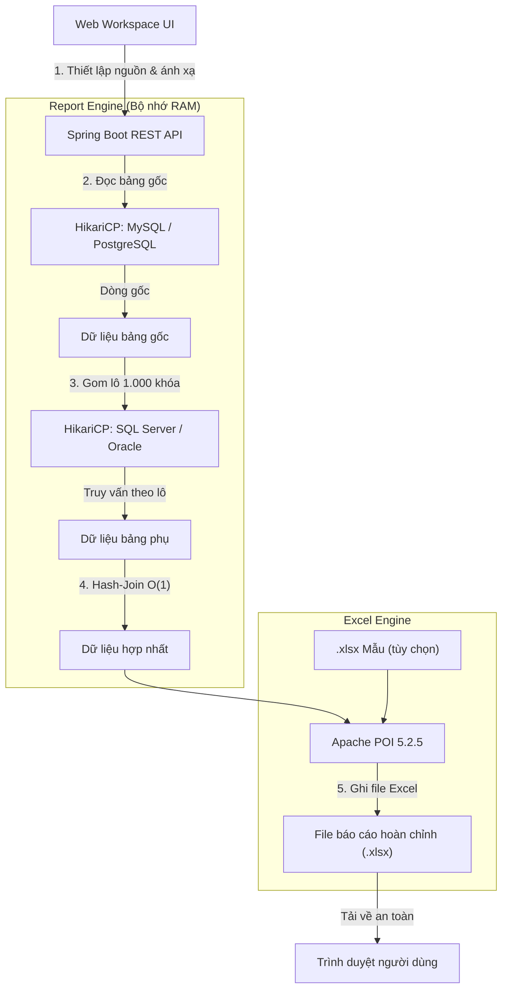
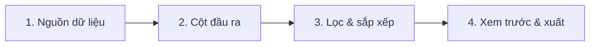

# Report Export Tool

> **Microservice Data Aggregation & Excel Stream Engine**  
> Công cụ tổng hợp dữ liệu phân tán liên cơ sở dữ liệu (Cross-Database Hash-Join) và stream xuất file Excel (`.xlsx`) dạng bảng mới hoặc điền trực tiếp vào file mẫu template giữ nguyên định dạng.

[](https://www.oracle.com/java/)
[](https://spring.io/projects/spring-boot)
[](https://poi.apache.org/)
[](https://vuejs.org/)
[](LICENSE)

---

## 1. Giới thiệu & Điểm nổi bật

Trong kiến trúc **Microservices** (*Database-per-Service*), các phân hệ (Đơn hàng, Khách hàng, CRM, Kế toán...) thường lưu trữ trên nhiều hệ quản trị cơ sở dữ liệu độc lập (MySQL, PostgreSQL, SQL Server, Oracle).

**Report Export Tool** giải quyết bài toán đối soát và kết xuất báo cáo tổng hợp:
- **Hash-Join trên RAM $O(1)$:** Ghép dữ liệu liên database tự động qua batching khóa (`IN (:keys)`), giảm thiểu độ trễ mạng qua LAN/VPN.
- **2 chế độ xuất linh hoạt:**
  - *Bảng Excel mới:* Sử dụng Apache POI SXSSF streaming siêu nhẹ, kiểm soát tiêu đề, thứ tự, kiểu dữ liệu và định dạng.
  - *Dùng file mẫu (Template):* Tự động điền dữ liệu vào sheet đầu tiên của file `.xlsx` sẵn có, giữ nguyên toàn bộ font chữ, màu sắc, viền khung và công thức.
- **Quản lý mẫu báo cáo tiện lợi:** Lưu trữ, nạp lại, đổi tên và quản lý danh sách mẫu báo cáo đã lưu; có nút làm mới nhanh cấu hình.
- **Tự phục hồi kết nối (Auto-Retry):** Nhận diện lỗi kết nối JDBC tạm thời và tự động thử lại một lần an toàn mà không làm gián đoạn tác vụ.
- **An toàn & bảo mật:** Kết nối `ReadOnly`, chống SQL Injection bằng whitelist identifier, không lưu mật khẩu vào ổ đĩa, hỗ trợ HTTP Basic Auth khi chia sẻ mạng.

---

## 2. Kiến trúc & Công nghệ

### Bảng công nghệ

| Tầng | Công nghệ | Vai trò & Điểm sáng |
| :--- | :--- | :--- |
| **Backend Core** | Java 21 LTS + Spring Boot 3.3.4 | Hiệu năng cao, kiến trúc phi trạng thái, sẵn sàng với Virtual Threads. |
| **Data Access** | Spring JDBC + HikariCP | Quản lý pool động, kết nối ReadOnly an toàn cho môi trường sản xuất. |
| **Database Adapters** | PostgreSQL, MySQL, SQL Server, Oracle | Tích hợp sẵn 4 driver chính thức, chuẩn hóa quote identifier và phân trang dialect. |
| **Join Engine** | In-Memory Hash-Join | Batch 1.000 IDs mỗi đợt, ghép nối dữ liệu trong bộ nhớ RAM với độ phức tạp $O(1)$. |
| **Excel Engine** | Apache POI 5.2.5 (OOXML / SXSSF) | Hỗ trợ stream hàng chục nghìn dòng, giữ nguyên cấu trúc template, xử lý số lớn (>15 số). |
| **Frontend UI** | Vue 3 + Pure CSS (Đóng gói nội bộ) | Giao diện 4 bước trực quan, responsive desktop/mobile, không phụ thuộc Node.js khi chạy. |

### Sơ đồ luồng dữ liệu



---

## 3. Khởi động nhanh (Quick Start)

### Yêu cầu
- **Java (JDK):** 21 trở lên.
- **Maven:** 3.9 trở lên.

### Chạy ứng dụng

```powershell
# 1. Clone mã nguồn
git clone https://github.com/Khanhnv26/Report_Export_Tools.git
cd Report_Export_Tools

# 2. Chạy ứng dụng
mvn spring-boot:run
```

*(Hoặc đóng gói JAR để chạy độc lập):*
```powershell
mvn clean package -DskipTests
java -jar target/microservice-report-tool-1.0.0.jar
```

Mở trình duyệt tại: **`http://localhost:8080`** (hệ thống sẽ tự động mở trên trình duyệt mặc định).

---

## 4. Quy trình làm việc 4 bước (Workflow)



1. **Bước 1 — Nguồn dữ liệu:**
   - Chọn database và bảng gốc, tích chọn các cột cần lấy.
   - Thêm nguồn phụ ghép nối (JOIN), chọn khóa nguồn và khóa đích tương ứng.
2. **Bước 2 — Cột đầu ra:**
   - Chọn chế độ *Bảng Excel mới* hoặc *Dùng file mẫu* (`.xlsx`).
   - Tinh chỉnh tên tiêu đề, kéo thả hoặc bấm nút để đổi thứ tự cột, chọn kiểu dữ liệu và định dạng hiển thị.
3. **Bước 3 — Lọc & sắp xếp:**
   - Lọc theo khoảng ngày (tối ưu đẩy xuống database xử lý).
   - Thêm điều kiện lọc sau ghép (VÀ) và chọn cột sắp xếp kết quả.
4. **Bước 4 — Xem trước & xuất:**
   - Bấm **Tạo preview** để kiểm tra dữ liệu thực tế trước khi xuất file.
   - Bấm **Tạo file Excel** để kích hoạt tác vụ chạy nền, theo dõi tiến trình và tải file về máy khi hoàn tất.

Chi tiết xem tại [Tài liệu hướng dẫn Report Workspace](docs/REPORT_WORKSPACE.md).

---

## 5. Cấu hình & Biến môi trường

| Biến môi trường | Mặc định | Ý nghĩa |
| :--- | :--- | :--- |
| `REPORT_MAX_ROWS` | `50000` | Giới hạn số dòng tối đa cho mỗi lần xuất báo cáo (chống tràn RAM). |
| `REPORT_TOOL_BIND_ADDRESS` | `127.0.0.1` | Địa chỉ IP lắng nghe (`0.0.0.0` để chia sẻ qua mạng nội bộ/VPN). |
| `REPORT_TOOL_USERNAME` | *(trống)* | Tên đăng nhập khi bật bảo vệ truy cập mạng ngoài. |
| `REPORT_TOOL_PASSWORD` | *(trống)* | Mật khẩu truy cập HTTP Basic Auth (bắt buộc khi bind ra ngoài localhost). |
| `REPORT_DB_PASSWORD_<ID>` | *(trống)* | Tự động cấp mật khẩu cho database đã lưu theo ID (VD: `REPORT_DB_PASSWORD_DB_CRM`). |

---

## 6. Đóng gói file cài đặt (.exe) bằng `jpackage`

Để phân phối cho người dùng cuối chạy như ứng dụng máy tính độc lập (không cần cài Java):

```powershell
mvn clean package -DskipTests

jpackage `
  --type app-image `
  --name "ReportExportTool" `
  --input target/ `
  --main-jar microservice-report-tool-1.0.0.jar `
  --main-class org.springframework.boot.loader.launch.JarLauncher `
  --dest dist/ `
  --win-shortcut `
  --win-menu
```

File thực thi sẽ nằm tại: `dist/ReportExportTool/ReportExportTool.exe`.

---

## 7. Kiểm thử tự động (Testing)

```powershell
# Chạy toàn bộ Unit & Integration Test Backend (62 tests)
mvn test

# Chạy kiểm thử hồi quy logic Frontend
node src/test/js/app-regression.mjs

# Chạy kiểm thử tự động giao diện trình duyệt (Playwright)
npm run test:browser
```

---

## 8. Giấy phép (License)

Dự án được phân phối theo giấy phép [MIT License](LICENSE).
